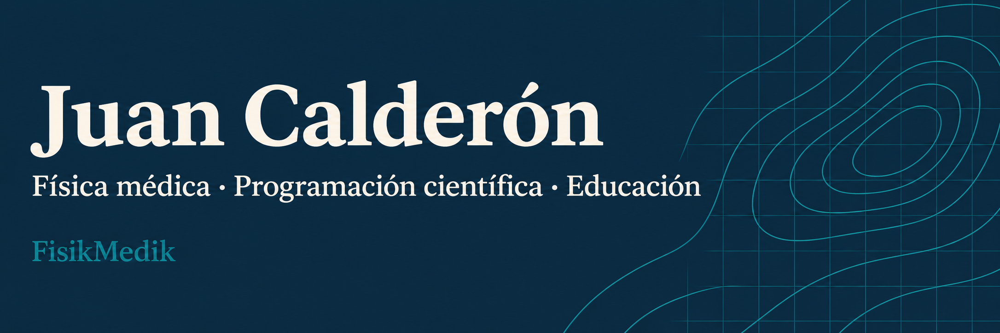

  <a href="#proyectos-destacados">Proyectos</a> ·
  <a href="https://fisikmedik.github.io/taller-imagenes-medicas-python/">Taller de imágenes médicas</a> ·
  <a href="#contacto">Contacto</a>

## Sobre mí

Soy **Juan Calderón**, físico médico en **Tegucigalpa, Honduras**. Mi actividad profesional incluye consultoría en diseño de búnkeres de radioterapia, calibración de equipos radiológicos y garantía de calidad en radiología.

En este espacio comparto **recursos educativos, visualizaciones y proyectos con Python y MATLAB**. Me interesa hacer comprensibles los conceptos de física médica mediante ejemplos que se puedan observar, ejecutar y modificar.

## Proyectos destacados

### Imágenes médicas con Python

**Recurso docente · Escuela de Machine Learning y Data Science en Honduras 2026**

Un taller introductorio para explorar imágenes cerebrales y comprender histogramas, curvas de nivel, filtros y bordes. Comienza mostrando imágenes y avanza hacia el código y la interpretación de los resultados.

- **Para practicar:** cuaderno de 60 minutos con 8 celdas, explicaciones y ejercicios resueltos; recorrido completo de 24 lecciones para profundizar.
- **Para enseñar y estudiar:** 16 diapositivas con notas del instructor y un manual ilustrado de 95 páginas con fuente LaTeX.
- **Para explorar:** herramienta interactiva que permite comparar cortes, contraste, histograma y umbral, incluso sin conexión.

Utiliza una plantilla pública MNI152 y conserva la procedencia de los datos, los parámetros y las salidas. La ruta breve se comprobó localmente y en Google Colab con CPU.

**[Explorar el taller](https://fisikmedik.github.io/taller-imagenes-medicas-python/)** · [Abrir en Colab](https://colab.research.google.com/github/FisikMedik/taller-imagenes-medicas-python/blob/main/Taller_en_vivo_60min.ipynb) · [Ver el repositorio](https://github.com/FisikMedik/taller-imagenes-medicas-python)

---

### TBI Setup

**Visualización geométrica · MATLAB**

Ilustración de un montaje de irradiación corporal total (*Total Body Irradiation*, TBI): posición de la fuente, isocentro, distancias, límites del haz y ángulos. El código permite estudiar las relaciones geométricas del esquema.

Su alcance es un modelo geométrico ilustrativo, sin cálculo dosimétrico.

[Explorar TBI Setup](https://github.com/FisikMedik/TBI-Setup) · [Leer el código MATLAB](https://github.com/FisikMedik/TBI-Setup/blob/main/TBISetUp.m)

---

### Dilema del estudiante

**Proyecto exploratorio · Python y Matplotlib**

Exploración de escenarios de estudio y trabajo mediante supuestos parametrizados y gráficos de evolución del patrimonio. Una práctica de modelado para observar cómo las decisiones del modelo influyen en sus resultados.

[Explorar el proyecto y sus supuestos](https://github.com/FisikMedik/Dilema-del-estudiante)

## Herramientas presentes en estos proyectos

| Área | Herramientas |
|---|---|
| Cálculo y visualización | Python, MATLAB, NumPy, Matplotlib y SciPy |
| Imágenes médicas | NiBabel, Nilearn y formato NIfTI |
| Aprendizaje práctico | Jupyter Notebook y Google Colab |
| Documentación y publicación | LaTeX, GitHub y GitHub Pages |

## Contacto

Para conversar sobre física médica, recursos docentes o visualización científica:

**[fisikmedik@gmail.com](mailto:fisikmedik@gmail.com)** · [Canal de YouTube](https://www.youtube.com/channel/UCXMx66_bN6oc_VXa1aCwpXw) · [X / @fileoshn](https://twitter.com/fileoshn)

Los datos, el código y los materiales conservan las condiciones indicadas en cada repositorio. La portada es una ilustración abstracta generada con IA; no representa datos médicos.
